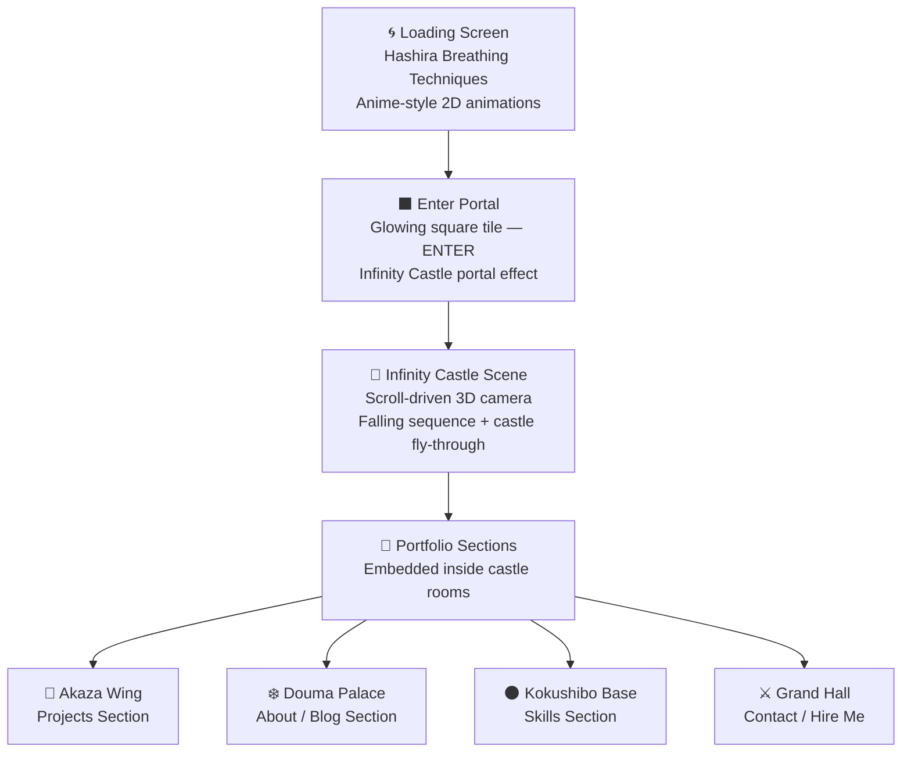

# 🏯 Portfolio V3 — Demon Slayer: Infinity Castle
## Full Implementation Plan

---

> [!IMPORTANT]
> **Concept Core:** Recreate the climactic end of Demon Slayer Season 4 Episode 8 — where all Hashira fall into the Infinity Castle — as the interactive skeleton of the portfolio. The user "falls" through and explores the castle via scroll-driven camera movement.

---

## 🗺️ Big Picture Architecture



---

## 🧰 Tech Stack

| Layer | Tool | Reason |
|---|---|---|
| Framework | React + Vite (already installed) | Current stack |
| 3D Engine | Three.js + `@react-three/fiber` | Already installed |
| 3D Helpers | `@react-three/drei` | Already installed |
| Scroll Engine | **GSAP ScrollTrigger** | Industry standard for scroll-driven 3D camera |
| Post-Processing | `@react-three/postprocessing` | Already installed — bloom, chromatic aberration |
| 2D Animations | **CSS + Canvas API** (loading) | Anime-style frame animation |
| Audio | Web Audio API | Dynamic sound per section |
| 3D Models | `.glb` / `.gltf` via `useGLTF` | Sketchfab / self-modeled in Blender |

> [!TIP]
> **Install needed:** `npm install gsap @gsap/react` — GSAP ScrollTrigger is the cleanest way to link scroll position to Three.js camera path without fighting React state.

---

## 📦 Asset Strategy

### ✅ CONFIRMED: Hybrid Approach
- **Sketchfab first** — search "Infinity Castle", "Demon Slayer castle" for free `.glb` models
- **Blender for signature items** — Douma's fan, Akaza's crystal, Kokushibo's katana (unique, portfolio-worthy)
- **2D sprite animations** for Hashira (confirmed — no heavy 3D characters needed)

#### Sketchfab Search Priority List
1. Infinity Castle corridor / hall
2. Japanese traditional architecture modular pieces
3. Wisteria / bloom particles (can be particle system)
4. Stone/dark castle walls

#### Blender Creation List
- Douma's decorative hand fan
- Akaza's blood-ice crystal formation
- Kokushibo's crescent moon katana
- Kasugai Crow (Contact section mascot)

---

## 🎬 Phase 1 — Loading Screen (Hashira Breathing Showcase)

### Concept
Each Hashira appears one by one with their breathing technique animation as 3D assets load in background.

### Sub-phases

```
[Rengoku — Flame Breathing] → [Tengen — Sound Breathing] → [Mitsuri — Love Breathing]
→ [Muichiro — Mist Breathing] → [Gyomei — Stone Breathing] → [Sanemi — Wind Breathing]
→ [Giyu — Water Breathing] → [Obanai — Serpent Breathing] → [Shinobu — Insect Breathing]
                                     ↓
                    [All 9 Hashira revealed simultaneously]
                    [Screen shatters like stone → ENTER tile appears]
```

### Implementation Choices — ✅ LOCKED

| Element | Approach | Rationale |
|---|---|---|
| Hashira visuals | **2D anime-style CSS/Canvas sprite animations** ✅ | True anime feel, lightweight, accurate to the show |
| Breathing effects | CSS particle system + WebGL shaders | Flame, water, wind each need distinct feels |
| Background | Three.js canvas with dark void + subtle fog | Ties loading into main 3D scene |
| Progress tracking | Actual `useProgress` hook from drei | Real load progress, not fake timers |
| Audio | **Full Demon Slayer OST** ✅ — Hashira Meeting → zone-specific tracks | Immersive, thematic per demon wing |

### Hashira Animation Specs

```
Each hashira:
  - Duration: ~3 seconds
  - Entrance: Slide from darkness with blur → sharpen
  - Breathing FX: Character-specific color particle burst
  - Name card: Kanji + English title, brushstroke reveal
  - Exit: Dissolve → next hashira
```

---

## 🟥 Phase 2 — The ENTER Portal Tile

### Concept
After loading, screen shows single glowing square tile center-screen. Clicking it tears open the portal to the Infinity Castle.

### Visual Design
```
┌─────────────────────────────┐
│                             │
│         ┌───────┐           │
│         │       │           │
│         │ ENTER │  ← Glowing, pulsing border
│         │       │    with demon-mark kanji
│         └───────┘           │
│                             │
└─────────────────────────────┘
```

- Background: Pitch black with **very subtle moonlight** rays
- Tile: Dark stone texture, cracking at edges, blood-red/crimson glow
- Text: "ENTER" in Japanese brush font + "境界を越えろ" (Cross the boundary)
- On hover: Tile cracks open, purple/void energy seeps from edges
- On click: **Full portal transition** — tile expands to fill screen with void vortex → scene begins

### Portal Transition Shader
- Custom GLSL distortion shader: spiral warp + chromatic aberration
- Duration: ~2 seconds
- Fades into first frame of Infinity Castle descent

---

## 🏯 Phase 3 — Infinity Castle Scroll Experience

### Core Architecture
```
Total scroll height: ~800vh (8x viewport heights)
Camera path: Predefined Bezier curve through castle geometry
Scroll % → Camera position/rotation on curve
```

### Scene Breakdown (Scroll Segments)

| Scroll % | Scene | Content |
|---|---|---|
| 0–10% | **Free fall opening** | ✅ Stylized **name cards** for each Hashira fall through the void — kanji name + breathing style text, rushing past camera. Stars and castle fragments blur past. |
| 10–25% | **Castle entry — Grand Corridor** | First castle walls appear. Wisteria light filters through windows. Hero intro text |
| 25–40% | **Rengoku's Flame Wing** | Corridor lit with torch flames. **Projects Section** embedded as framed "mission scrolls" on walls |
| 40–55% | **Akaza's Arena** | Stone arena, ice/blood crystal decorations. **Skills Section** — each skill displayed as a combat technique |
| 55–70% | **Douma's Palace** | Ornate, frozen aesthetic. Fan motifs on walls. **About Me** section — "who is this demon?" |
| 70–85% | **Kokushibo's Sanctum** | Dark moon chamber, katana display. **Blog / Writing** section |
| 85–100% | **Grand Hall — Final Battle Site** | Where Tanjiro + Hashira converge. **Contact / Hire Me** section |

### Camera Path Implementation

```typescript
// Conceptual — GSAP ScrollTrigger + Three.js camera
const cameraPath = new THREE.CatmullRomCurve3([
  new THREE.Vector3(0, 100, 0),    // Sky — free fall
  new THREE.Vector3(0, 60, 20),   // Entry corridor
  new THREE.Vector3(20, 40, 40),  // Rengoku Wing
  new THREE.Vector3(-30, 20, 80), // Akaza Arena
  new THREE.Vector3(10, 10, 120), // Douma Palace
  new THREE.Vector3(-10, 5, 160), // Kokushibo Sanctum
  new THREE.Vector3(0, 0, 200),   // Grand Hall
]);

// ScrollTrigger maps scroll progress → point on curve
ScrollTrigger.create({
  onUpdate: (self) => {
    const point = cameraPath.getPoint(self.progress);
    camera.position.copy(point);
  }
});
```

---

## 🎨 Section Design Details

### Projects Section (Rengoku's Wing)
- Projects appear as **stone wall scrolls / mission tablets**
- Hover: Scroll unrolls with flame particle effect
- Each project card = a "battle record"
- Tech stack = "breathing style used"
- Demo/GitHub = sword icons that glow on hover

### Skills Section (Akaza's Arena)
- Skills displayed as **combat techniques**
- Skill level = ring indicator (like stamina circles)
- Categories = different fighting styles
- Akaza's crystal motif as background decoration

### About Section (Douma's Palace)
- Timeline displayed on ornate fan panels
- "Who is Shreeharsh?" written as a "demon compendium entry"
- Photo with anime-style vignette frame
- Douma's icy aesthetic: frosted glass, snow particle ambient

### Blog Section (Kokushibo's Sanctum)
- Blog posts as **ancient moon scrolls**
- Moon breathing motif — crescent highlights
- Dark, meditative atmosphere

### Contact Section (Grand Hall)
- "Request an Audience" form design
- Tanjiro's mark as decorative header
- Submit = "Send a Crow" (Kasugai Crow messenger motif)
- Social links as Hashira family crests

---

## 🌀 Special Interactive Easter Eggs

| Element | Trigger | Effect |
|---|---|---|
| Douma's Hand Fan | Click fan decoration | Fan unfolds with ice particles, shows secret "fun facts" |
| Kokushibo's Katana | Hover | Katana glows, moon breathing slash across screen |
| Rengoku's Haori | Hidden corner | Fire burst + Rengoku quote |
| Kasugai Crow | Floats through castle | Click for contact shortcut |
| Upper Moon marks | Scatter throughout | Clicking all 6 unlocks secret easter egg page |

---

## 🔊 Audio Design

| Zone | Audio | Notes |
|---|---|---|
| Loading | "Hashira Meeting" OST | Tense, ceremonial |
| Portal Enter | Void whoosh SFX | Custom layered |
| Free Fall | Wind rush + "Corps Theme" | Dynamic volume based on fall speed |
| Rengoku Wing | "Flame Hashira" theme | Fire crackle ambience |
| Akaza Arena | Combat percussion OST | Akaza battle theme |
| Douma Palace | Haunting strings | Douma's eerie elegance |
| Kokushibo | Low drones + biwa | Ancient, dark |
| Grand Hall | "Gurenge" instrumental | Full orchestral |

> [!NOTE]
> All audio will respect the mute button from current implementation. Smooth cross-fade between zones using Web Audio API `GainNode`.

---

## ⚡ Performance Strategy

| Challenge | Solution |
|---|---|
| Heavy 3D scene | **Frustum culling** — only render visible castle segments |
| Multiple GLB models | Progressive loading during loading screen; LOD (Level of Detail) |
| Scroll jank | GSAP ScrollTrigger on `requestAnimationFrame` path |
| Mobile performance | Reduced geometry fallback + 2D parallax mode |
| Initial bundle size | Lazy load each castle wing as separate chunk |

---

## 🗓️ Phased Execution Plan

### Phase 1 — Foundation (Week 1)
- [ ] Install GSAP + set up ScrollTrigger integration with R3F
- [ ] Create camera path utility + scroll binding
- [ ] Build basic castle corridor geometry (procedural boxes first, replace with GLB later)
- [ ] Establish lighting rig (moonlight, torch light, volumetric fog)

### Phase 2 — Loading Screen (Week 1–2)
- [ ] Design Hashira animation sequence (CSS + Canvas 2D)
- [ ] Implement breathing technique particle effects per Hashira
- [ ] Real progress tracking via `useProgress`
- [ ] Portal tile design + click transition

### Phase 3 — Castle Sections (Week 2–3)
- [ ] Implement each wing's geometry + lighting theme
- [ ] Embed portfolio content into each section
- [ ] Section transitions (camera arrives → content fades in)

### Phase 4 — Asset Integration (Week 3–4)
- [ ] Source/create GLB models
- [ ] Replace procedural geometry with real castle model
- [ ] Character silhouettes for falling sequence

### Phase 5 — Polish (Week 4)
- [ ] Audio zones + crossfading
- [ ] Easter eggs
- [ ] Post-processing (bloom, fog, SSAO)
- [ ] Mobile fallback
- [ ] Performance audit

---

## ✅ Design Decisions — ALL CONFIRMED

| Decision | Choice |
|---|---|
| Hashira in loading | 2D anime-style CSS/Canvas sprite animations |
| Castle geometry | Sketchfab first + Blender for demon signature items |
| Scroll behavior | Pinned scroll — Apple-style camera path |
| Falling sequence | Name cards (kanji + breathing style) falling — minimalist & elegant |
| Audio | Full Demon Slayer OST — zone-specific per demon wing |

---

## 🚀 Build Order — Start Here

### Sprint 1 (Build Now)
1. Install GSAP + create scroll-camera binding proof of concept
2. Build loading screen: 9 Hashira CSS animation sequence + breathing particles
3. Portal tile design + click-to-enter transition

### Sprint 2
4. Castle corridor geometry (placeholder boxes → real GLB)
5. Camera bezier path through full castle
6. Falling name card sequence (0–10%)

### Sprint 3
7. Each wing's lighting + atmosphere
8. Embed portfolio content into each section
9. Audio zone crossfading

### Sprint 4
10. Real GLB models from Sketchfab
11. Blender demon items integrated
12. Post-processing, easter eggs, polish

---

## 🔭 Scope of Improvements — Future Vision

### V3.1 — Depth Upgrades
| Improvement | Impact | Effort |
|---|---|---|
| **Procedural castle generation** — algorithmically generate new corridor layouts | Infinite replayability, no two visits the same | High |
| **Dynamic weather system** — rain, fog, cherry blossoms per wing | Massively elevates atmosphere | Medium |
| **Ambient creature system** — demons crawling on walls in background | Creepy, immersive lore accuracy | Medium |
| **Interactive torches** — click to light/extinguish; affects section reveal | Tactile, memorable interaction | Low |
| **Tanjiro's scar as cursor** — custom SVG cursor shaped like the mark | Subtle but beautiful detail | Low |

### V3.2 — Narrative Upgrades
| Improvement | Impact | Effort |
|---|---|---|
| **Animated Hashira dialogue** — speech bubbles appear as you enter their wing | Connects portfolio content to character lore | Medium |
| **Demon encounter events** — random "demon appears" popups with lore-accurate poses | Surprise delight moments | Medium |
| **Breathing technique tutorial** — hovering skill cards shows the "form" animation | Unique way to display skill mastery levels | High |
| **Hidden Upper Moon rooms** — secret sections unlocked by finding all 6 moon marks | Viral Easter egg potential | High |
| **Taisho Secret panels** — small Tanjiro/Inosuke chibi panels like in the manga | Adds humor, personality, fans will love it | Low |

### V3.3 — Technical Upgrades
| Improvement | Impact | Effort |
|---|---|---|
| **Real-time shadows** — Three.js shadow maps tied to torch positions | Huge visual upgrade | Medium |
| **Screen-space reflections** — wet castle floors reflecting the scene | Premium, cinematic look | High |
| **Depth-of-field** — blur foreground/background based on camera focus point | Cinematic realism | Low (postprocessing) |
| **Volumetric lighting shafts** — light beams through windows like in the anime | Iconic visual from the show | Medium |
| **Instanced geometry** — repeat corridor segments with zero performance cost | Castle can be arbitrarily large | Medium |
| **WebXR mode** — VR headset support for walking through the castle | Showcase-worthy, cutting-edge | Very High |

### V3.4 — Content Upgrades
| Improvement | Impact | Effort |
|---|---|---|
| **Case study rooms** — each project gets its own "chamber" in the castle | More depth per project | Medium |
| **Live GitHub stats** — pillars that visually grow with your commit streak | Dynamic, shows activity | Low |
| **Blog as "Demon Compendium"** — blog posts styled as demon encyclopedia entries | Thematic consistency | Low |
| **Testimonials as "Hashira endorsements"** — styled as official Corps approval stamps | Creative social proof | Low |
| **Resume as "Corps Registration Scroll"** — downloadable PDF with Demon Slayer theming | Memorable, shareable | Low |

---

## 🟠 Blender Guide for Beginners — Building the Demon Slayer Assets

> [!NOTE]
> You're building **4 key items** in Blender: Douma's Hand Fan, Akaza's Crystal, Kokushibo's Katana, and the Kasugai Crow. These range from easy to medium difficulty. Perfect for a Blender beginner.

### 🛠️ Blender Setup (Do This First)

```
1. Download Blender (free): https://www.blender.org/download/
2. Install these FREE add-ons (Edit → Preferences → Add-ons):
   - "Node Wrangler" (already built-in, just enable it)
   - "Extra Objects" (built-in) — for stylized shapes
3. Set render engine to "EEVEE" (not Cycles) — faster for game-ready assets
4. Install the "glTF 2.0" exporter (built-in) — needed to export .glb for Three.js
```

### 📐 Essential Blender Shortcuts to Learn First
| Shortcut | Action |
|---|---|
| `G` | Grab/Move |
| `S` | Scale |
| `R` | Rotate |
| `G + X/Y/Z` | Move along specific axis |
| `Tab` | Toggle Edit Mode ↔ Object Mode |
| `Ctrl + R` | Loop Cut (add edge loops) |
| `E` | Extrude |
| `Alt + Click` | Select edge loop |
| `Numpad 1/3/7` | Front / Right / Top view |
| `Numpad 0` | Camera view |
| `F12` | Render |
| `Ctrl + Z` | Undo (yes it works the same) |

---

### 🪭 Asset 1 — Douma's Hand Fan *(Difficulty: Easy — 30 min)*

**What it looks like:** A traditional Japanese folding fan with intricate spider-web/ice patterns on the fabric.

**Step-by-step:**
```
1. New File → Delete default cube (X → Delete)
2. Add → Mesh → Circle (set vertices to 16 in bottom-left popup)
3. Tab into Edit Mode
4. Select half the vertices (box select B), delete them (X → Vertices)
   → You now have a semicircle (the fan's open shape)
5. Select all (A), Extrude (E) → Z → 0.02 (very thin)
6. Add "Subdivision Surface" modifier (wrench icon → Add Modifier)
   → Set Viewport to 2
7. Add "Solidify" modifier → thickness 0.005
8. For the ribs: Add → Mesh → Cylinder
   → Scale it to be a thin long rod
   → Duplicate (Shift+D) and rotate to fan out across the fan face
   → 8-10 ribs total
9. Material:
   → Fan fabric: deep crimson/red (#8B0000) with slight transparency (alpha 0.85)
   → Ribs: gold metallic (#FFD700), Metallic: 1.0, Roughness: 0.1
10. Export: File → Export → glTF 2.0 → name "douma_fan.glb"
```

**Improvement tips:**
- Use a texture image for the fan fabric (find "japanese fan pattern" on Unsplash, free)
- Add a subtle ice-blue emission shader mixed with the base color for Douma's cold aesthetic
- The ribs can have a very slight curve using a "Curve" modifier

---

### 🔮 Asset 2 — Akaza's Blood-Ice Crystal *(Difficulty: Easy — 20 min)*

**What it looks like:** A jagged, tall crystal formation — sharp, geometric, dark crimson with inner glow.

**Step-by-step:**
```
1. Add → Mesh → Cone
   → Set vertices to 6 (hexagonal cross-section) in the popup
   → Depth: 3.0, Top Radius: 0.0, Bottom Radius: 0.5
2. Tab → Edit Mode → select top vertex → move up (G + Z) slightly to sharpen
3. Add Modifier: "Displace"
   → Create a new Texture (Clouds type, Scale 0.8)
   → Strength: 0.15 (adds jagged surface noise)
4. Duplicate (Shift+D) → scale down → rotate and position to cluster 3-5 crystals
5. Material (Principled BSDF):
   → Base Color: dark blood red (#4A0010)
   → Transmission: 0.7 (makes it glass-like)
   → IOR: 1.8
   → Emission: #FF2020 at strength 0.3 (inner glow)
6. Add a Point Light inside the crystal cluster, color #FF4444, strength 2.0
7. Export as "akaza_crystal.glb"
```

**Improvement tips:**
- Use the "Geometry Nodes" modifier (advanced) to scatter crystal shards procedurally
- Add a subtle "Subsurface Scattering" to make light bleed through edges
- Animate a gentle rotation in Three.js after import — crystals that slowly spin look amazing

---

### ⚔️ Asset 3 — Kokushibo's Crescent Moon Katana *(Difficulty: Medium — 1-2 hrs)*

**What it looks like:** A massive katana with a crescent moon tsuba (guard), dark purple/black blade with moonlight patterns.

**Step-by-step:**
```
BLADE:
1. Add → Mesh → Cube → Scale: X=0.02, Y=0.01, Z=1.2 (long thin rectangle)
2. Tab → Edit Mode → select top face
3. Scale X slightly to taper the tip (blade gets thinner toward point)
4. Extrude up → move to a point (the kissaki/tip)
5. Add a slight curve: Add Modifier "Simple Deform" → Bend → Axis Y → Angle 5°

TSUBA (Guard — the crescent moon):
6. Add → Mesh → Torus → set Inner Radius to 0.06, Outer Radius 0.08
   → This becomes the circular base of the guard
7. Delete half the torus vertices to make a crescent shape
8. Extrude inward for thickness
9. Add decorative notches with loop cuts (Ctrl+R)

HANDLE (Tsuka):
10. Add → Mesh → Cylinder → Scale X=0.025, Y=0.025, Z=0.3
11. Wrap pattern: add a "Texture" of diagonal lines (simulate the ito wrapping)

MATERIALS:
- Blade: near-black (#0D0015) with purple metallic sheen
  → Metallic: 0.9, Roughness: 0.05
  → Emission: #4400AA at 0.2 (moonlight shimmer along edge)
- Tsuba: dark silver, engraved moon pattern
- Handle: dark maroon wrapped look

12. Export as "kokushibo_katana.glb"
```

**Improvement tips:**
- The hardest part is the crescent guard — don't stress if it's not perfect, it'll look great from a distance
- Look up "Blender katana tutorial" on YouTube (Dikko's channel is excellent) for the blade geometry
- In Three.js, add a `PointLight` that follows the blade tip and pulses — pure magic

---

### 🐦 Asset 4 — Kasugai Crow *(Difficulty: Medium — 1-2 hrs)*

**What it looks like:** A stylized crow, slightly anime/chibi-ish. Used in the Contact section as a messenger.

**Step-by-step:**
```
BODY:
1. Add → Mesh → UV Sphere → Scale to egg shape
   (S → Z → 0.7 to squish vertically)
2. Smooth it: Right-click → Shade Smooth

HEAD:
3. Duplicate sphere → scale down to 0.5x → position above and forward

BEAK:
4. Add → Mesh → Cone → scale very small, sharpen → position on face

WINGS (simplified):
5. Add → Mesh → Plane → Tab into Edit Mode
6. Extrude out in a wing arc shape
7. Use "Shrinkwrap" modifier to drape wing over body slightly
8. Duplicate, mirror (X axis) for the other wing

EYES:
9. Add → Mesh → UV Sphere (tiny) → place on head sides
10. Material: white with black pupil (two overlapping spheres)

FEATHERS (optional but nice):
11. Use Blender's Particle System → Hair → type "Feathers" effect
    → Keep it very subtle or skip for now

MATERIALS:
- Body + wings: Pure matte black (#050505), Roughness: 0.9
- Eyes: white (#FFFFFF) base + black (#000000) small sphere on top
- Beak: dark orange (#994400)

RIGGING (for animation — optional):
12. Add Armature (Shift+A → Armature → Single Bone)
    → Create bones for body, each wing, head
    → Parent mesh to armature (Ctrl+P → With Automatic Weights)
    → Animate wings flapping: 3 keyframes (up, neutral, down)

13. Export with animation: File → Export → glTF 2.0
    → Check "Include → Selected Objects" and "Animation"
    → Name: "kasugai_crow.glb"
```

**Improvement tips:**
- Watch "Low poly bird in Blender" on YouTube — directly applicable to this
- The crow doesn't need to be hyper-realistic; a slightly stylized, smooth crow looks better in anime context
- In Three.js: use `useAnimations` from `@react-three/drei` to play the wing-flap loop automatically

---

### 📤 Exporting from Blender to Three.js — Checklist

```
Before export:
✅ Apply all modifiers (Ctrl+A → Apply All Modifiers in Object Mode)
✅ Apply scale (Ctrl+A → Scale) — prevents weird scaling in Three.js
✅ Origin to center (Object → Set Origin → Origin to Geometry)
✅ Remove unused materials
✅ Triangulate faces (Tab → Select All → Mesh → Faces → Triangulate)

Export settings (File → Export → glTF 2.0):
✅ Format: glTF Binary (.glb) — single file, easier to load
✅ Include: Selected Objects (only export what you need)
✅ Transform: Y Forward, Z Up (Three.js coordinate system)
✅ Geometry: Apply Modifiers ✓, UVs ✓, Normals ✓
✅ Animation: checked if you have animations
✅ Compression: Draco compression (reduces file size 5-10x — install Draco add-on first)
```

---

### 🎓 Blender Learning Resources for This Project

| Resource | What to Learn | Link |
|---|---|---|
| **Blender Guru — Donut Tutorial** | Core fundamentals (do this first, 3 hrs total) | YouTube search |
| **Dikko — Anime Character** | Stylized anime modeling style | YouTube search |
| **Grant Abbitt — Low Poly** | Low-poly game assets (perfect for web) | YouTube search |
| **Blender Official Docs** | Modifier reference | docs.blender.org |
| **Sketchfab** | Study other Demon Slayer models for reference | sketchfab.com |
| **r/blender** | Ask for help, extremely welcoming community | reddit.com/r/blender |

> [!TIP]
> **Beginner tip:** Don't try to make everything perfect on the first try. Build a rough version, export it to Three.js, see how it looks in the browser — that feedback loop is the fastest way to improve. The castle will be dark and atmospheric anyway, which hides a lot of polygon imperfections!

---

### 🔄 Improvement Loop — How to Iterate

```
V3.0 (Launch):
  → Procedural castle geometry (Three.js boxes/planes as stand-ins)
  → Blender assets: Fan + Crystal only (easiest)
  → 2D CSS Hashira animations in loading
  → Core scroll camera path working

V3.1 (Polish):
  → Import real Sketchfab castle GLB
  → Add Katana + Crow from Blender
  → Post-processing pass (bloom, fog, DOF)
  → Audio zones

V3.2 (Expand):
  → Upper Moon hidden rooms
  → Taisho Secret panels
  → WebXR proof of concept
  → Procedural generation experiments
```

---

## 🏯 Building the Infinity Castle — Complete Construction Guide

> [!IMPORTANT]
> The Infinity Castle is **not one building** — it's dozens of traditional Japanese castle towers, corridors, and bridges stacked, rotated, and twisted at impossible angles inside an infinite void. The key architectural trick is **modular construction**: build 6–8 reusable building pieces, then assemble them in insane configurations.

---

### 🔍 Step 0 — Study the Reference Material (Do This Before Touching Blender)

Before building anything, spend 30 minutes studying the castle's actual appearance:

```
Reference sources:
1. Demon Slayer S4 Ep 8 — pause and study every frame of the castle
2. Search Pinterest: "Infinity Castle Demon Slayer architecture"
3. Search ArtStation: "Infinity Castle fanart" — fan artists often break it down well
4. Search YouTube: "Infinity Castle 3D breakdown" or "Mugen Castle Blender"
5. Look at real Japanese castle references:
   - Himeji Castle (most iconic silhouette)
   - Matsumoto Castle (dark, black exterior — very close to Infinity Castle)
   - Osaka Castle (multi-tiered pagoda roofs)
```

**Key observations from the show:**
- **Black/dark wood** exterior — no bright colors, everything is shadow-toned
- **Curved pagoda roofs** — multiple tiers per tower, upward curving eaves
- **Impossible geometry** — buildings at 90°, 180° rotations; gravity doesn't apply
- **Wisteria light** — soft purple/pink glowing flowers hanging from some areas
- **Lanterns** — paper lanterns float between structures (key light sources)
- **Stone bridges** — narrow walkways connecting towers at all angles
- **Infinite depth** — the void beyond the castle goes on forever, fog obscures it

---

### 📥 Step 1 — Sketchfab Import as Base Reference

#### What to Search For
```
Sketchfab search terms (in order of priority):
1. "infinity castle" — direct match
2. "demon slayer castle" — fan-made versions
3. "matsumoto castle" — real castle, extremely similar aesthetic
4. "japanese pagoda" — roof architecture reference
5. "traditional japanese architecture" — structural pieces
6. "japanese castle tower" — standalone tower models
```

#### How to Download and Import into Blender
```
1. On Sketchfab, filter by: Free + Downloadable
2. Download as .glb or .fbx format (prefer .glb)
3. In Blender: File → Import → glTF 2.0 (.glb/.gltf)
   OR File → Import → FBX (if .fbx)
4. The model appears in your scene
5. CRITICAL: Don't use it as-is — use it only as:
   a. Visual reference (study proportions, move it to a hidden layer)
   b. A base to strip down and rebuild on top of
   c. Extract individual pieces (a roof, a pillar) and reuse those
```

#### What to Extract from the Reference Model
```
Even if the full model isn't perfect, extract these pieces:
- Curved pagoda roof tile mesh → use as template for your own roof
- Pillar proportions → measure and note height/width ratios
- Window/shoji screen shapes → reference for your own geometry
- Overall scale → how big is a tower relative to a person?
```

> [!TIP]
> In Blender, you can press `H` to hide objects and `Alt+H` to show them. Put the reference model on a separate Collection (like a layer) and hide it while you work, reveal it to check proportions.

---

### 🧱 Step 2 — The Modular Building Strategy

The Infinity Castle is built from **repeating modules**. You only need to model these **8 pieces**:

```
MODULE 1: Castle Tower Body
  → A rectangular/octagonal column, the main "trunk" of each tower
  → Height ratio: roughly 3:1 (tall and narrow)
  → Dark wood planks texture on sides

MODULE 2: Pagoda Roof Tier (Small)
  → The curved upswept roof, one tier
  → Build ONE, duplicate and stack for multi-tier towers
  → The most important piece — get this right and everything looks great

MODULE 3: Pagoda Roof Tier (Large)
  → Wider version of Module 2 for base floors
  → Same mesh, just scaled differently

MODULE 4: Corridor/Bridge
  → A long narrow walkway connecting towers
  → Has railings on sides, wooden floor planks
  → Can be straight OR curved — make both variants

MODULE 5: Wooden Pillar
  → A single decorative pillar with carved top and bottom
  → Used inside corridors and as structure supports

MODULE 6: Stone Base Platform
  → The foundation block towers sit on
  → Stone texture, slightly crumbled edges

MODULE 7: Hanging Lantern
  → Paper lantern, simple geometry
  → Will have emission material (glows) — main light source in scene

MODULE 8: Wisteria Cluster
  → Hanging flower cluster, stylized/low-poly
  → Purple/pink emission for atmospheric light
```

---

### 🏗️ Step 3 — Building Each Module (Beginner-Friendly)

#### MODULE 2: The Pagoda Roof (Most Important — Start Here)
```
This is the heart of the castle. If this looks good, everything looks good.

1. Add → Mesh → Cylinder (set vertices to 8 for octagonal shape)
   → Scale: X=2.0, Y=2.0, Z=0.3 (wide and flat)

2. Tab into Edit Mode → Select top face
3. Scale inward (S → 0.6) → this creates the sloped roof surface

4. Select the outer bottom edge loop (Alt+Click the bottom ring)
5. Extrude DOWN (E → Z → -0.15) → creates the overhang/eave
6. Scale this bottom ring OUT (S → 1.3) → eave curves outward

7. Now the eave tips need to curve UP (anime/Japanese style):
   → Select just the 8 corner vertices of the outer eave
   → Move them UP (G → Z → 0.2)
   → This creates the classic upswept eave tips

8. Add "Subdivision Surface" modifier → Level 2 → smooth everything out

9. The roof ridge (top decoration):
   → Add → Mesh → Cube → scale tiny → place on top center
   → Add small decorative finials at each corner eave tip

10. For multi-tier towers: duplicate the roof, scale to 80%, place above
    → Repeat 2-3 times for traditional 3-tier pagoda look

MATERIAL:
   → Dark grey/black tiles: #1A1A1A, Roughness: 0.8, Metallic: 0.0
   → Very slight green tint (#1A1E1A) for aged look
   → Add a "Bump" texture (brick/tile pattern) for surface detail
```

#### MODULE 1: Castle Tower Body
```
1. Add → Mesh → Cube → Scale: X=1.0, Y=1.0, Z=4.0 (tall column)
2. Tab → Edit Mode → add 3 horizontal loop cuts (Ctrl+R then scroll wheel)
   → These loops define where each floor is
3. For each floor, slightly inset the faces:
   → Select floor band faces → Inset (I → 0.05) → push in slightly
   → Creates the layered floor appearance

4. Windows (Shoji screens):
   → Select a face on the side → Inset (I → 0.2)
   → Extrude inward (E → -0.05) → this creates window recess
   → In the recess, add a grid of thin crossing bars (Ctrl+R many times)
   → This is the shoji screen pattern

5. MATERIAL — Wood planks:
   → Base Color: very dark brown #1A0F05
   → Roughness: 0.85, Metallic: 0.0
   → Add "Wood" procedural texture (Shader Editor):
     Node Wrangler: Ctrl+Shift+T → find wood texture image
     OR use Noise Texture → ColorRamp → plug into Base Color
```

#### MODULE 4: Corridor/Bridge
```
1. Add → Mesh → Plane → Scale: X=0.8, Y=5.0 (long narrow plank)
2. Tab → Edit Mode → add loop cuts along length (Ctrl+R × 8)
   → This gives planks their individual floor board look
3. Extrude down (E → Z → -0.1) → give it thickness
4. For railings:
   → Add → Mesh → Cylinder (thin, tall) → duplicate many times along sides
   → Add a horizontal rail bar: Cube, scaled long and thin, along top of posts
5. Optional: slight sag/bow in the middle (Edit Mode → Proportional Editing O key → move center down slightly)

MATERIAL:
   → Same dark wood as tower body
   → Floor planks slightly lighter (#221208) to differentiate
```

#### MODULE 7: Hanging Lantern
```
1. Add → Mesh → UV Sphere → Scale: X=0.3, Y=0.3, Z=0.4 (slightly tall)
2. Tab → Edit Mode → select top and bottom poles → delete them
   → You have a lantern body shape
3. Add → Mesh → Cylinder (very thin, short) → place as top cap
4. Add → Mesh → Cylinder (thin, very short) → bottom ring
5. For the hanging string: Add → Curve → Bezier → shape into drooping line

MATERIAL — This is crucial for scene lighting:
   → Body: translucent orange-white: #FFE8C0, Transmission: 0.8
   → Add EMISSION node: color #FFA040, Strength: 3.0
   → This lantern GLOWS and lights the surrounding geometry ← key effect
```

#### MODULE 8: Wisteria Cluster
```
1. Add → Mesh → UV Sphere → scale small → this is one flower cluster
2. Duplicate many times (Shift+D) → scatter randomly in a hanging bunch
3. Add a "Particle System" to emit tiny spheres = individual flowers
4. Add a hanging vine/stem: Curve → Bezier, hang from above

MATERIAL:
   → Flowers: soft purple #9B59B6, slight emission at 0.5 strength
   → This creates the signature purple glow around wisteria areas
   → In Demon Slayer lore, wisteria is poison to demons — perfect atmospheric detail
```

---

### 🌐 Step 4 — Assembling the Castle (The Fun Part)

This is where you recreate the **impossible geometry** of the Infinity Castle.

```
LAYER SETUP in Blender (use Collections):
├── Collection: "Modules" (hide this — source pieces)
│   ├── TowerBody
│   ├── RoofSmall
│   ├── RoofLarge
│   ├── Corridor
│   ├── Pillar
│   ├── StonePlatform
│   ├── Lantern
│   └── Wisteria
│
└── Collection: "Castle_Assembly" (the actual scene)
    ├── Wing_Rengoku (projects section)
    ├── Wing_Akaza (skills section)  
    ├── Wing_Douma (about section)
    ├── Wing_Kokushibo (blog section)
    └── Grand_Hall (contact section)
```

#### Assembly Rules — How to Make it Feel Like Infinity Castle
```
Rule 1: NEVER align buildings the same way
  → Each tower should be at a different rotation
  → Some at 90°, some at 45°, some completely upside down
  → In Blender: select tower → R (rotate) → pick wild angle

Rule 2: Impossible connections look intentional
  → Corridors can connect at 70° angles
  → Bridges can curve UP to meet an inverted tower
  → This IS the Infinity Castle — gravity doesn't apply

Rule 3: Depth layering
  → Place buildings in FRONT of and BEHIND the camera path
  → Things in the background: scaled down + more fog
  → Things up close: full detail
  → Creates parallax depth when camera moves

Rule 4: The void matters as much as the buildings
  → Leave large empty spaces between structures
  → The nothingness is part of the aesthetic
  → Fill it with: floating debris, distant castle silhouettes, lanterns

Rule 5: Camera path first, then build around it
  → Define your camera path (the bezier curve in Three.js)
  → Build only what the camera actually sees
  → You can leave entire areas empty if camera never goes there
  → This saves massive modeling time
```

#### Assembly Reference Layout (Bird's Eye View)
```
        [Upside-down Tower C]
               |
[Tower A] ----Bridge---- [Tower B rotated 45°]
    |                          |
   [Corridor twisting down]    |
    |                    [Corridor spiraling up]
[Tower D]                      |
    |               [Tower E — Douma's Palace]
[Bridge curving]               |
    |              [Tower F inverted — Kokushibo]
[Grand Hall]
```

---

### 🎨 Step 5 — Materials & Texturing the Castle

> [!NOTE]
> You don't need to UV unwrap everything for a web project. Procedural textures (generated in Blender's shader editor) look great and require zero texture painting.

#### Master Material: Dark Castle Wood
```
Shader Editor setup (N-panel → Shader Editor):
1. Principled BSDF node (default)
2. Add: Texture → Noise Texture
   → Scale: 20.0, Detail: 8.0, Roughness: 0.7
3. Add: Color → ColorRamp
   → Left stop: #0D0804 (near black)
   → Right stop: #2A1505 (dark brown)
4. Connect: Noise → ColorRamp → Base Color of BSDF
5. Set Roughness: 0.85, Metallic: 0.0
6. Add another Noise Texture → connect to Roughness socket
   → This makes roughness vary across surface = aged, worn look
```

#### Master Material: Castle Stone
```
1. Principled BSDF
2. Noise Texture (Scale: 8, Detail: 6)
3. ColorRamp: #1A1A1A → #2D2D2D (dark grey range)
4. Connect to Base Color
5. Roughness: 0.95 (very matte stone)
6. Add Bump node between ColorRamp and Normal socket
   → Creates 3D surface texture without extra geometry
```

#### Master Material: Roof Tiles
```
1. Principled BSDF
2. Wave Texture (type: Bands) → simulate tile rows
3. ColorRamp: #111111 → #1E1E1E
4. Connect to Base Color
5. Roughness: 0.7 (slightly shiny — glazed ceramic tiles)
6. Very subtle Metallic: 0.05 for wet tile look
```

#### Atmospheric Materials
```
Wisteria Glow:
  → Base: #6B1FA8
  → Emission: #9B59B6 at strength 1.5
  → Translucency: 0.3

Lantern Paper:
  → Base: #FFF0D0
  → Emission: #FFA040 at strength 4.0
  → Transmission: 0.7 (light passes through)

Void/Sky material (World shader):
  → Background color: #000000 (pure black)
  → Add stars: Noise Texture (tiny scale) → Map Range (narrow) → 
    only shows bright speckles = stars
  → Add subtle fog: Volume Scatter in World volume socket
    color: #050010 (near-black purple), density: 0.01
```

---

### 💡 Step 6 — Lighting the Castle

Lighting is what makes the Infinity Castle feel alive. Every light source in the anime is either a lantern, wisteria glow, or moonlight.

```
LIGHT SETUP:

1. Moon Light (Key Light):
   → Add → Light → Sun
   → Color: #C0C8FF (cold blue-white moonlight)
   → Strength: 2.0
   → Angle: 15° from horizontal (raking light across roofs)
   → Rotation: comes from upper left

2. Wisteria Ambient (Fill Light):
   → Add → Light → Area (large, placed above the scene)
   → Color: #6B1FA8 (deep purple)
   → Strength: 0.5 (very subtle purple fill)
   → This is what gives the whole scene the purple tint

3. Lantern Lights (Point Lights):
   → For every lantern object: Add → Light → Point
   → Color: #FFA040 (warm amber)
   → Strength: 50 (bright but short range)
   → Radius: 0.3
   → Place one inside each lantern mesh
   → These are the most important lights — they create pools of warm light in darkness

4. Torch/Brazier (per wing):
   → Rengoku Wing: Add → Light → Point, color #FF4500 (fire orange), strength 80
   → Akaza Wing: Add → Light → Spot, color #FF0000 (blood red), strength 60
   → Douma Wing: Add → Light → Area, color #ADD8E6 (ice blue), strength 30
   → Kokushibo Wing: Add → Light → Point, color #4400AA (deep purple), strength 40

5. God Rays (Window light shafts):
   → In EEVEE: Render Properties → Volumetrics → enable
   → Tile Size: 4, Steps: 8
   → This makes light shafts visible through foggy atmosphere
   → Place Spot lights outside windows pointing inward
```

---

### ⚡ Step 7 — Performance Optimizations (Critical for Web)

The castle will be heavy. These steps cut file size and GPU load dramatically.

#### Polygon Budget Per Module
```
Keep these limits strictly or Three.js will struggle:

Module              Target Polys    Maximum Polys
Tower Body          800             1,500
Roof Tier           600             1,000
Corridor (5m)       400             800
Pillar              200             400
Stone Platform      300             600
Lantern             150             300
Wisteria Cluster    200             500

Total castle target: under 100,000 polys for the full scene
(Three.js handles 500k fine but we want 60fps with postprocessing)
```

#### Polygon Reduction Techniques
```
1. Decimate Modifier:
   → Select a module → Add Modifier → Decimate
   → Set Ratio to 0.5 (halves polygon count)
   → Check the mesh still looks OK from camera distance
   → Background objects can go to 0.2 ratio (very low poly, barely visible anyway)

2. Manual cleanup:
   → Tab → Edit Mode → Select All (A) → Mesh → Clean Up → Merge by Distance
   → This removes duplicate vertices (common source of hidden poly waste)
   → Also: Select All → Mesh → Clean Up → Delete Loose (removes floating edges)

3. LOD Strategy (Level of Detail):
   → Make 3 versions of each tower: Full, Medium (50%), Low (20%)
   → In Three.js: switch between LODs based on camera distance
   → drei has a built-in <Detailed> component for this

4. Instancing — The Biggest Win:
   → In Three.js, use THREE.InstancedMesh for repeated modules
   → One corridor mesh → render 50 corridors at almost zero extra GPU cost
   → This is how the castle can be "infinite" without crashing the browser
```

#### Texture/Material Optimization
```
1. Use procedural materials in Blender (already recommended above)
   → When exporting, "bake" them to a 512×512 texture per material type
   → Baking: Render Properties → Bake → Diffuse → select object → Bake
   → This converts procedural materials into small image files

2. Texture Atlas:
   → Pack ALL castle textures into ONE 2048×2048 image
   → Drastically reduces draw calls in Three.js
   → In Blender: UV editing can be used to arrange all UVs on one canvas

3. Draco Compression on export:
   → Reduces .glb file size by 70-90%
   → Install "Draco" add-on for Blender (free, from Google)
   → Enable in export settings
```

---

### 📦 Step 8 — Exporting the Castle for Three.js

#### Export Strategy — Don't Export Everything at Once
```
Export as separate files per wing section:
  castle_corridor_entry.glb    ← Grand corridor (10–25% scroll)
  castle_rengoku_wing.glb      ← Flame wing (25–40%)
  castle_akaza_arena.glb       ← Arena (40–55%)
  castle_douma_palace.glb      ← Palace (55–70%)
  castle_kokushibo_sanctum.glb ← Sanctum (70–85%)
  castle_grand_hall.glb        ← Grand hall (85–100%)
  castle_modules.glb           ← Shared modules (pillars, lanterns, etc.)

WHY: Three.js can lazy-load each file as user scrolls into that zone
This means initial load is tiny — only the first section loads upfront
```

#### Export Checklist for Castle
```
Before export:
✅ Apply ALL modifiers on ALL objects (important — Decimate must be applied)
✅ Apply scale on ALL objects (Ctrl+A → Scale in Object Mode, then All)
✅ Join repeated modules into one mesh per type (reduces draw calls)
   → Select all corridor pieces → Ctrl+J to join them
✅ Remove all lights (Three.js has its own lighting system)
✅ Remove cameras
✅ Clean up material names (no spaces, no special characters)
✅ Remove any hidden objects you don't want exported
✅ Check file size — each .glb should be under 5MB ideally

Export Settings:
  Format: glTF Binary (.glb)
  Transform: +Y Up (Three.js coordinate)
  Geometry: Apply Modifiers ✅, Compress ✅ (Draco)
  Materials: Export ✅, Images: Automatic
  Animation: only if you have animated objects
```

---

### 🔗 Step 9 — Integrating into Three.js / React Three Fiber

```typescript
// Load each wing separately — lazy loaded as user scrolls
import { useGLTF, Detailed } from '@react-three/drei'

// Preload first section immediately, rest on demand
useGLTF.preload('/models/castle_corridor_entry.glb')

// LOD component for towers
function CastleTower({ position, rotation }) {
  const { scene: high } = useGLTF('/models/tower_high.glb')
  const { scene: mid }  = useGLTF('/models/tower_mid.glb')
  const { scene: low }  = useGLTF('/models/tower_low.glb')

  return (
    <Detailed distances={[0, 30, 80]}>
      <primitive object={high.clone()} />
      <primitive object={mid.clone()} />
      <primitive object={low.clone()} />
    </Detailed>
  )
}

// Instanced corridors — 50 corridors, one draw call
function CastleCorridors({ positions }) {
  const { scene } = useGLTF('/models/castle_modules.glb')
  const corridorMesh = scene.getObjectByName('Corridor')
  
  return (
    <instancedMesh 
      args={[corridorMesh.geometry, corridorMesh.material, positions.length]}
    >
      {/* Three.js handles instancing automatically */}
    </instancedMesh>
  )
}

// Lanterns with actual point lights baked in
function Lantern({ position }) {
  return (
    <group position={position}>
      <primitive object={lanternMesh} />
      <pointLight color="#FFA040" intensity={50} distance={8} decay={2} />
    </group>
  )
}
```

---

### 🚨 Common Mistakes to Avoid

| Mistake | What Happens | Fix |
|---|---|---|
| Not applying scale before export | Model appears 100x bigger or 0.01x smaller in Three.js | Always `Ctrl+A → Scale` before export |
| Too many individual objects | Hundreds of draw calls = browser lag | Join same-material objects with `Ctrl+J` |
| High-poly details in background | Rendering unseen geometry | Use Decimate modifier on everything more than 20m from camera path |
| Forgetting Y-up coordinate transform | Castle appears sideways in Three.js | Set `+Y Up` in export settings |
| Exporting materials with HDR textures | Massive file size | Bake to 512px PNG before export |
| No fog/atmosphere | Castle looks like floating objects in empty space | Add `<fog attach="fog" args={['#000005', 30, 200]} />` in Three.js scene |
| Using Cycles render engine | EEVEE is 100x faster for this type of work | Switch to EEVEE in Render Properties |
| Modeling the whole castle in one session | Burnout, messy file | Model one module per session, test in Three.js each time |

---

### 🗓️ Recommended Castle Build Timeline (for Blender Beginner)

```
Week 1 — Learn & prototype:
  Day 1–2: Complete Blender Guru donut tutorial (fundamentals)
  Day 3:   Model the Pagoda Roof (Module 2) — spend time here
  Day 4:   Model Tower Body (Module 1) + Corridor (Module 4)
  Day 5:   Export to Three.js, see it in browser, celebrate 🎉

Week 2 — Complete modules:
  Day 6:   Lantern + Pillar + Stone Platform
  Day 7:   Wisteria Cluster
  Day 8:   Material pass on all modules (shader editor)
  Day 9:   Import Sketchfab reference, extract useful pieces
  Day 10:  Assemble first wing (Grand Corridor entry)

Week 3 — Full castle assembly:
  Day 11:  Rengoku's Flame Wing geometry
  Day 12:  Akaza's Arena
  Day 13:  Douma's Palace + Kokushibo's Sanctum
  Day 14:  Grand Hall
  Day 15:  Lighting pass across full castle

Week 4 — Optimization & export:
  Day 16:  Polygon reduction on all modules
  Day 17:  Texture baking
  Day 18:  Export all 6 wing files
  Day 19:  Integration into Three.js camera path
  Day 20:  Final visual tweaks with postprocessing
```

> [!TIP]
> **The single most important tip:** Export to Three.js after every single modeling session. Seeing your work in the browser — in context, with lighting — tells you more than staring at it in Blender viewport ever will. The real-time feedback loop will make you a better modeler faster than any tutorial.
